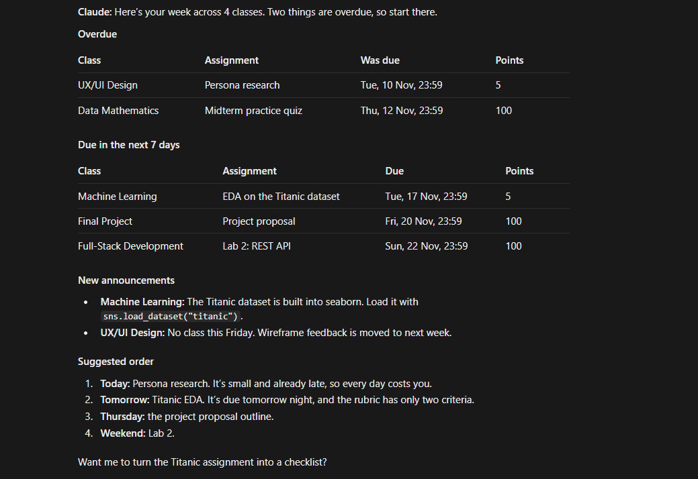
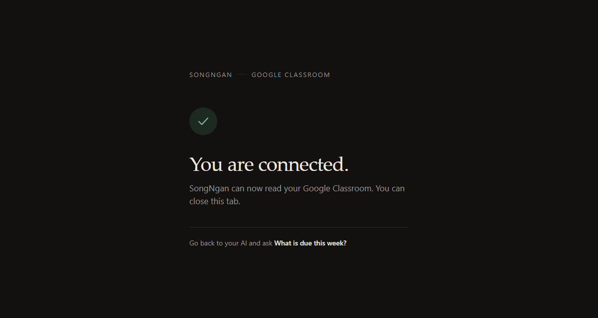

<div align="center">

# SongNgan

**A self-hosted MCP server for Google Classroom.**

Let Claude, Cursor, Gemini or any tool-calling AI see your classes, assignments, due dates, attached files and grades.


[Install](#install) · [Install with an AI agent](#install-with-an-ai-agent) · [Tools](#tools) · [Troubleshooting](#troubleshooting)

</div>

---

<p align="center">
  
  <br>
  <sub>Asking Claude "What's due this week?" with SongNgan connected. Sample data.</sub>
</p>

SongNgan runs on your own computer with your own Google Cloud OAuth client. There is no shared app, no server in between and nothing to pay for. Requests go straight from your machine to Google, and your sign-in token stays in the OS keychain.

## What you can ask

- "What's due this week?"
- "Summarize the Lab 3 instructions for Physics and read the attached PDF."
- "Any new announcements from my teachers?"
- "Which class has my lowest grade right now?"
- "Download the starter notebook for the Machine Learning assignment."
- "Put this due date on my Google Calendar."

## Install

You need [Node.js](https://nodejs.org) 20 or later, Git and a Google account that uses Classroom. Setup takes about ten minutes, once.

### 1. Create a Google OAuth client

Sign in to Google Cloud with any Google account. Each link below opens the right page; make sure your new project is selected at the top of the page.

1. [Create a project](https://console.cloud.google.com/projectcreate), for example `SongNgan`.
2. Enable the APIs you need, using **Enable** on each page:

   | API | Needed for |
   |---|---|
   | [Google Classroom API](https://console.cloud.google.com/apis/library/classroom.googleapis.com) | Always |
   | [Google Drive API](https://console.cloud.google.com/apis/library/drive.googleapis.com) | Reading, downloading or uploading files |
   | [Google Calendar API](https://console.cloud.google.com/apis/library/calendar-json.googleapis.com) | Adding due dates to your calendar |

3. Open [Google Auth Platform](https://console.cloud.google.com/auth/overview) and choose **Get started**. Set the app name to `SongNgan`, pick your email as the support email, choose the **External** audience, add your email as the contact and create it.
4. Open [Audience](https://console.cloud.google.com/auth/audience) and choose **Publish app**. Without this, Google signs you out every 7 days.
5. Open [Clients](https://console.cloud.google.com/auth/clients) and choose **Create client**. Set the application type to **Desktop app**, create it, then choose **Download JSON**. Keep this file private.

### 2. Build the server

```bash
git clone https://github.com/fluki3-06s/songngan-mcp.git
cd songngan-mcp
npm install
```

`npm install` also builds the server into `dist/index.js`.

### 3. Connect your Google account

```bash
npm run setup -- path/to/client_secret.json
```

Setup copies the client into `~/.song-ngan/`, asks which features to enable and opens Google sign-in in your browser. Google warns that the app is unverified; because the app is your own, choose **Advanced > Go to SongNgan**. When it finishes, the browser shows this page:

<p align="center">
  
</p>

Check the result:

```bash
npm run status
```

`Google account` should show your email and `Missing permissions` should not appear.

### 4. Register it with your AI client

Use the absolute path to `dist/index.js` in the folder you cloned.

```json
{
  "mcpServers": {
    "song-ngan": {
      "command": "node",
      "args": ["/absolute/path/to/song-ngan/dist/index.js", "serve"]
    }
  }
}
```

| Client | Where |
|---|---|
| Claude Desktop | Settings > Developer > Edit config (`claude_desktop_config.json`) |
| Claude Code | `claude mcp add song-ngan -s user -- node /absolute/path/to/song-ngan/dist/index.js serve` |
| Cursor | `~/.cursor/mcp.json` |
| VS Code | `.vscode/mcp.json`, using `"servers"` and `"type": "stdio"` |
| Gemini CLI | `~/.gemini/settings.json` |
| LM Studio, Windsurf | the client's `mcp.json` |

On Windows, write the path with forward slashes or escaped backslashes, for example `"D:/Tools/song-ngan/dist/index.js"`.

Restart the client and ask: "What's due this week?"

### Update

```bash
git pull
npm install
```

Restart your AI client afterwards. Your sign-in and settings in `~/.song-ngan/` are kept. If `npm run status` then shows `Missing permissions`, the new version needs extra access; run `npm run setup` once to grant it.

## Install with an AI agent

SongNgan can be installed by an AI coding agent such as Claude Code, Cursor or Gemini CLI. Give it this prompt:

> Install the SongNgan MCP server for me by following AGENTS.md in https://github.com/fluki3-06s/songngan-mcp.

The agent follows [AGENTS.md](AGENTS.md). It does everything except the steps only you can do: creating the OAuth client in Google Cloud Console and approving the Google sign-in.

## Tools

Tools are grouped into features. `read` is always on; `files` and `write` are chosen during setup.

| Tool | Feature | Description |
|---|---|---|
| `weekly_digest` | read | Overdue work, upcoming due dates and recent announcements in one call |
| `list_courses` | read | Enrolled classes |
| `list_assignments` | read | Assignments with status (`pending`, `overdue`, `submitted`, `returned`), topic, due date and grade; filter by class, topic, status or due window |
| `get_assignment` | read | Full instructions, topic, attached materials, grading rubric and your submission with turn-in time, days late and the history of state and grade changes |
| `search` | read | Find assignments, announcements and materials by keyword across classes |
| `list_topics` | read | Topics (units or chapters) teachers use to group classwork |
| `list_people` | read | Teachers and classmates in a class |
| `list_announcements` | read | Teacher announcements |
| `list_course_materials` | read | Materials posted in a class |
| `get_grades` | read | Graded work and per-class totals |
| `read_material` | files | Google Docs, Slides, Sheets and Drawings, PDF (scanned pages as images), Word, PowerPoint, Excel, OpenDocument, images, text and code, ZIP listings, video previews |
| `download_material` | files | Save an attached file to `Downloads/SongNgan` (notebooks, code, datasets, templates); Google Docs, Slides and Sheets are saved as `.docx`, `.pptx` and `.xlsx` |
| `read_link` | files | Web pages, public Google Forms, online PDFs and Office files, YouTube metadata, Drive links |
| `upload_to_drive` | write | Upload a local file to Google Drive |
| `attach_to_assignment` | write | Attach a Drive file to your submission (see note) |
| `turn_in` | write | Turn in an assignment; requires `confirm: true` |
| `add_to_calendar` | write | Add a due date to Google Calendar with reminders 1 day and 1 hour before |

> [!NOTE]
> Google only lets an app change submissions for assignments created by that same app. For assignments a teacher created on the Classroom website, `attach_to_assignment` returns a clear error with a link so you can attach the file yourself.

To change features later, run `npm run setup` again.

Read tools also return `structuredContent` with a published `outputSchema`, so clients and agents get typed JSON instead of parsing text.

## Prompts

Ready-made prompts appear in clients that support MCP prompts, for example as slash commands in Claude.

| Prompt | Arguments | What it does |
|---|---|---|
| `plan_week` | `days` (optional) | Day-by-day study plan from overdue and upcoming work |
| `assignment_checklist` | `courseId`, `assignmentId` | Summarizes an assignment and its materials into a checklist of deliverables |
| `check_against_rubric` | `courseId`, `assignmentId`, `work` (optional file path) | Reviews your draft against the rubric or instructions before you turn it in |

## Resources

Clients that support MCP resources can attach Classroom data to a chat directly.

| URI | Content |
|---|---|
| `songngan://courses` | Your active classes |
| `songngan://courses/{courseId}` | One class with all of its assignments |
| `songngan://courses/{courseId}/assignments/{assignmentId}` | One assignment with materials, rubric and submission; open work is listed for quick picking |

## CLI

Run from the cloned folder with `node dist/index.js <command>`.

| Command | Description |
|---|---|
| `setup [client_secret.json]` | Connect a Google account and choose features |
| `status` | Sign-in state, enabled features and storage location |
| `logout` | Revoke access at Google and delete the local token |
| `tools [--format openai]` | Print tool schemas (`openai`, `anthropic`, `gemini`, `mcp`) |
| `call <tool> '<json>'` | Run a tool from the terminal |
| `serve` | Start the MCP server over stdio |

## Configuration

| Variable | Description |
|---|---|
| `SONGNGAN_HOME` | Config folder, default `~/.song-ngan` |
| `SONGNGAN_CLIENT_SECRET` | Path to `client_secret.json`, default `~/.song-ngan/client_secret.json` |
| `SONGNGAN_FEATURES` | Comma-separated features, e.g. `files,write`; overrides setup |
| `SONGNGAN_ENABLE_FILES`, `SONGNGAN_ENABLE_WRITE` | `true` or `false` toggles |
| `SONGNGAN_TOKEN_STORE` | Set to `file` to skip the OS keychain |

## Troubleshooting

| Problem | Fix |
|---|---|
| `OAuth client: missing` in `status` | Run `npm run setup -- path/to/client_secret.json`. |
| `Access blocked` or `admin_policy_enforced` | Your school blocks third-party apps. Ask IT to allow it. |
| `access_denied` | Access was not approved, or the app is still in testing mode. Publish it under **Audience**. |
| `Google denied access ... API` | Enable that API in your Google Cloud project. |
| Signed out every 7 days | The app is in testing mode. Publish it under **Audience**. |
| `Missing permissions` after enabling a feature | Run `npm run setup` again to grant the new scopes. |
| The AI client does not list the tools | Check the absolute path to `dist/index.js`, then fully restart the client. |
| Cannot attach a file to an assignment | A Google limit, see the note under [Tools](#tools). Attach it from the returned link. |

## Privacy and security

- Everything runs locally under your own OAuth client. There is no SongNgan server and no telemetry.
- `client_secret.json` is copied to `~/.song-ngan/`. Never commit it.
- The refresh token is stored in the OS keychain (macOS Keychain, Windows Credential Manager, libsecret). Without a keychain it falls back to `~/.song-ngan/token.json` with `0600` permissions.
- Scopes are requested per feature, and write access is off by default.
- `node dist/index.js logout` revokes the token at Google and deletes it locally.

| Feature | Scopes |
|---|---|
| read | `classroom.courses.readonly`, `classroom.coursework.me.readonly`, `classroom.announcements.readonly`, `classroom.courseworkmaterials.readonly`, `classroom.topics.readonly`, `classroom.rosters.readonly` |
| files | `drive.readonly` |
| write | `classroom.coursework.me`, `drive.file`, `calendar.events` |

## Development

```bash
npm run check        # typecheck, lint, format check and tests
npm run format       # apply Prettier
npm run build
npm run inspect      # MCP Inspector against dist/index.js
```

```
src/
├── core/
│   ├── google/      Classroom, Drive and Calendar gateways
│   ├── readers/     File and link readers
│   ├── tools/       Tool base class, read, file and write tools, registry
│   ├── study.ts     Assignments, search, topics, people, digest and grades
│   └── ...          Config, auth, token store, cache, retry
├── adapters/        MCP server (tools, prompts, resources) and JSON schema export
├── cli/             Commands and terminal UI
├── application.ts   Composition root
├── index.ts         CLI entry
└── lib.ts           Library entry
```

To add a tool, extend `Tool` in `src/core/tools/`, register it in `ToolRegistry.catalog()` and add a test. See [CONTRIBUTING.md](CONTRIBUTING.md) for the full workflow and [CHANGELOG.md](CHANGELOG.md) for release notes.

## License

[MIT](LICENSE)
